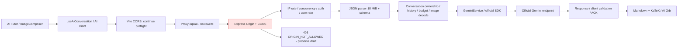

# Math Mentor — AI connection root-cause report

**Ngày:** 12/10/2026, Asia/Saigon.  
**Kết quả:** sửa chặn Origin LAN, nạp lại allowlist hiện tại, đồng bộ preflight qua Vite/Express và sửa phân loại lỗi backend offline. Backend vẫn **Gemini Mode**. Đã có response Gemini thật cho text và ảnh/context. Một số lượt 503 vẫn tồn tại và được ghi riêng, không che bằng Mock.

## 1. Forensic audit và bảo toàn source

Đã đọc yêu cầu đính kèm; kiểm tra `git status`, `git diff`, source AI/frontend/backend/config/SDK/proxy, tests và các báo cáo hiện có. Giữ nguyên dirty changes của các giai đoạn trước. Không reset, xóa tính năng, commit hoặc push. Không sửa Dashboard, Signature WOW, theme, responsive CSS hay logic phòng thi.

Frontend gọi cùng origin `/api/ai/*`; không gọi Google hoặc truyền key. `/api/ai/status` chỉ chứng minh backend đã nạp cấu hình/key có mặt, không chứng minh Gemini đang trả lời.

## 2. Nguyên nhân đã xác minh

### A. Runtime dùng allowlist cũ sau khi sửa `.env`

- Tiến trình đang nghe 3001 ban đầu khởi động **04:58:23 UTC**, trong khi `.env` được sửa **05:32:54 UTC**.
- File thực tế có localhost, loopback và `http://192.168.0.109:8443`, nhưng runtime 3001 vẫn chặn Origin 192.168.0.109 với **403 / ORIGIN_NOT_ALLOWED**.
- Khởi động process Gemini kiểm chứng ở 3003 từ cùng file thì Origin đó đi qua middleware và tới schema (**422 / VALIDATION_ERROR** với body `{}`). Không dùng 422 làm bằng chứng Gemini thành công; chỉ dùng để xác định chỗ chặn. Process kiểm chứng đã đóng.
- Config được đọc một lần khi process khởi động. `dotenv` đã chạy trước `loadConfig`, đường dẫn file dựa trên entry URL và đúng ở source/build; không có bằng chứng cwd đọc nhầm file.
- `tsx watch` bỏ qua dotfile (`**/.*`, `**/.*/**`), kể cả khi thêm `--include .env`. Một kiểm tra runtime với flag đó không thấy PID đổi. Dev runner mới theo dõi metadata `.env`, yêu cầu tsx rerun bằng stdin; kiểm tra runtime sau sửa thấy PID đổi. Comment tạm được khôi phục, credentials/config giữ nguyên.

### B. Origin LAN đang dùng khác IP đã cấu hình

- NIC hiện tại của máy: **172.20.10.2**, còn LAN origin trong file trước sửa: **192.168.0.109**.
- Chrome truy cập `http://172.20.10.2:8443` gửi POST với Origin đó, qua Vite bị **403 / ORIGIN_NOT_ALLOWED**. Request ID mẫu: `4d6c502f-cc5b-4b72-8eec-120b1ca9d226`.
- Chỉ bổ sung origin cụ thể 172.20.10.2 vào `.env` local. Không auto-allow mọi NIC, không wildcard, không ép loopback vào allowlist production tùy ý. Hai loopback đã có trong cấu hình hiện tại và đều được phép.
- Trên localhost/127.0.0.1 trong môi trường Agent, lỗi Origin không tái hiện: đã được phép từ trước. Chưa đo trực tiếp URL của phiên lỗi gốc của người dùng; không khẳng định mọi 403 phát sinh từ cùng IP. Bằng chứng LAN/stale runtime ở trên là tái hiện thực tế.

### C. OPTIONS qua Vite từng dừng trước Express

- Trước sửa, OPTIONS qua 8443 trả **204**, không có `X-Request-ID` của Express. Với LAN, không có `Access-Control-Allow-Origin`; Origin lạ cũng trả 204 ở lớp Vite, trong khi POST thật vẫn bị backend chặn.
- Đây là preflight interception của Vite dev CORS, không phải bằng chứng backend cho phép Origin lạ. Same-origin fetch của AI Tutor thường không cần preflight, nên không gộp lỗi này với 403 POST ở mục B.
- Giữ đúng regex CORS loopback mặc định của Vite và thêm `preflightContinue=true` ở dev/preview. OPTIONS API tiếp tục tới Express; backend trả 204 cho origin được phép, 403 cho origin lạ và 400 cho method/header preflight không hỗ trợ.

### D. Hardening và lỗi phụ được sửa

- Allowlist cũ so sánh chuỗi literal, không chuẩn hóa hostname/default port/slash trong cấu hình; thêm parser fail closed, loại trùng, phân biệt config với request serialized origin.
- Proxy mất backend có thể trả 500/502 không phải JSON. Client trước đây báo `INVALID_RESPONSE`; nay phân loại `BACKEND_UNAVAILABLE`, giữ khác với JSON lỗi Gemini, Origin, quota và timeout.
- Phát hiện secret trong **`.env.example`**, file có thể commit. Key đã xuất hiện khi đọc file mẫu trong output kiểm tra. Đã loại bỏ, đặt template Mock/key trống, sửa comment dễ gây nhầm và thêm regression/build gate. **Key đã lộ cần được quản lý thu hồi/xoay lại.** Không in lại giá trị trong báo cáo; không tự thay key thật trong `.env`.

## 3. Luồng request và điểm chặn



Policy chỉ dùng `req.headers.origin`. **Host, Referer, x-forwarded-host và x-forwarded-proto không tương đương Origin và không cấp quyền**. `changeOrigin=false` giữ frontend Host/Origin. Thứ tự chặn trước parser, schema và Gemini; CORS không thay thế auth.

Missing Origin được chấp nhận cho CLI, production vẫn cần verified auth adapter. `null`, empty/malformed Origin, credentials/path/query/hash hoặc Origin không trong allowlist bị chặn. HTTP/HTTPS và port khác nhau vẫn khác origin. Slash cuối chỉ được chuẩn hóa ở **config**, request header có slash không hợp lệ bị từ chối.

## 4. File và cách sửa

| File | Thay đổi |
|---|---|
| `server/src/config/origins.ts` | Parser/normalizer shared trong backend, exact allowlist, fail closed |
| `server/src/config/environment.ts` | File path theo entry URL, precedence rõ ràng, metadata không chứa secrets |
| `server/src/config/env.ts` | Dùng parser allowlist mới |
| `server/src/index.ts` | Nạp env trước config; startup in allowlist hiệu lực/nguồn và hướng dẫn restart |
| `server/scripts/dev.mjs`, `server/package.json` | Giữ tsx source watch, theo dõi metadata `.env` để rerun process |
| `server/src/app.ts` | Origin normalize, request ID header, preflight method/header policy, xóa CORS headers cho Origin bị chặn, safe provider diagnostics |
| `server/src/errors.ts` | Chỉ giữ diagnostic HTTP/network code an toàn ở server, không trả raw error |
| `server/src/services/gemini.service.ts` | SDK khóa endpoint chính thức `https://generativelanguage.googleapis.com`, không để global base URL/Vertex flag đưa key ra endpoint tùy ý |
| `src/ai/aiClient.ts` | Lỗi Origin rõ hơn; phân biệt proxy offline/non-JSON 5xx với provider JSON error |
| `vite.config.ts` | CORS loopback giữ nguyên; API preflight tiếp tục tới Express ở dev/preview |
| `server/.env` | Chỉ thêm Origin LAN 172.20.10.2 cụ thể; key/model/mode được giữ; file vẫn Git ignore |
| `server/.env.example` | Key trống, template Mock, comment rõ file mẫu có thể commit |
| `server/tests/origin-environment.test.ts`, `server/tests/gemini-adapter.test.ts` | Regression Origin/env/proxy/preflight/offline/diagnostics/endpoint |
| `tests/ai-client.test.cjs`, `tests/ai-browser.spec.ts`, `tests/ai-example-secret.test.cjs` | Error classification, UI draft/recovery và key-free template |
| `scripts/check-ai-bundle.mjs` | Gate template key trống trước build; secret/SDK scan |
| `GEMINI_INTEGRATION_GUIDE.md`, báo cáo này | Hướng dẫn config có hiệu lực, watcher, Origin, test và handoff |

Không thêm dependency hoặc database cho sửa lỗi này. Không commit/push. Không thay backend 3001 sang Mock để che lỗi; Mock chỉ tồn tại ở fixtures riêng 3002/8444 và unit/API tests.

## 5. Bằng chứng trước/sau và request ID

| Kiểm tra | Trước sửa | Sau sửa |
|---|---|---|
| POST `{}` Origin localhost/127.0.0.1 | 422 schema, không bị Origin chặn | 422 schema |
| POST `{}` Origin 192.168.0.109 ở runtime cũ | 403; ID `99edbffc-2393-463e-a53b-b756c7d03cdf` | Cấu hình đã nạp lại, origin được phép |
| POST `{}` Origin 192.168.0.109 ở process fresh kiểm chứng | 422; ID `61f2fedd-3d97-441e-a578-fc62ceb1e5eb` | Process kiểm chứng đã đóng |
| Chrome LAN 172.20.10.2, invalid body | 403; ID `4d6c502f-cc5b-4b72-8eec-120b1ca9d226` | Status 200 Gemini; POST valid nhận response thật |
| OPTIONS LAN qua Vite | 204 tại Vite, không ACAO/request ID backend | 204, ACAO đúng LAN; ID `022b6920-b13f-4397-b432-908c07bb233d` |
| OPTIONS Origin lạ qua Vite | 204 tại Vite, không ACAO | 403, không ACAO; ID `a13a9140-a821-457f-95b8-289564bc00da` |
| Host/Referer/forwarded giả làm localhost | Không được coi là Origin | Negative tests vẫn bị chặn theo Origin thật |

Request ID là correlation UUID, không phải credential. Các phép kiểm request/SDK không in cookie, token hoặc raw SDK error; riêng sự cố key trong output đọc file mẫu được ghi rõ tại mục 2D và 9.

## 6. Kết quả kiểm thử

Môi trường Windows, Node 24.21.0, npm 11.19.0, Chrome headless. Node 22/pnpm full runtime matrix chưa chạy lại.

| Check | Kết quả |
|---|---|
| Frontend strict/no-unused typecheck | Đạt |
| Backend typecheck | Đạt |
| Frontend unit/regression | **83/83 đạt** |
| Backend HTTP/SDK/Origin/env/proxy + pure units | **32/32 đạt** (22 + 10) |
| Production Vite/server build | Đạt |
| Bundle isolation + template secret gate | Đạt |
| Browser regression production | **2/2 đạt** |
| Live `.env` watcher verification | PID thay đổi khi thêm comment tạm; restore comment, giữ cấu hình/credentials |
| Active credential scan source/docs | Không có match ngoài private `.env`; không in credential/hash |
| Local runtime status sau sửa | 200, provider Gemini/configured true |

Coverage: allowed localhost/loopback/configured LAN, disallowed LAN/host/protocol/port, missing/empty/null/malformed Origin, case/default port/config slash, preflight headers/method, Origin qua proxy, không rewrite path/Host, env path source/build/precedence/snapshot, valid/invalid payload, safe Gemini error mapping, retry cùng UUID, canonical history, image limits/decode, key-free template, error giữ draft/Orb/loading và các tính năng cũ.

Browser tests dùng Express rejection thật cho Origin âm tính; proxy offline response được mô phỏng riêng trong browser để kiểm UI, còn proxy offline thực tế được tái hiện bằng Vite fixture/backend đã đóng. Không coi fixtures là bằng chứng Google hoạt động.

Các lỗi test trung gian đã xử lý: Chrome không cho đổi Origin qua `route.continue` nên dùng HTTP context lấy rejection thật; Vite offline trả 502 thay vì giả định 500; regex kiểm key mẫu phải dùng horizontal whitespace để không nuốt newline. Kết quả cuối bên trên đã đạt.

## 7. Gemini thật và ảnh

- Browser tại **http://172.20.10.2:8443**, câu hỏi **“5 + 5 bằng bao nhiêu?”**: HTTP **200**, provider Gemini, response không rỗng, có kết quả 10. Request ID: `a43f7079-d8c5-42ab-aac8-ab62e5da960a`.
- Live browser LAN khác: text HTTP **200**, UUID fallback hợp lệ; lượt tiếp theo history 2 nhận **503 / AI_UNAVAILABLE** cả lần đầu và một Retry, draft giữ nguyên; lượt ảnh PNG tiếp theo vẫn dùng history 2 đã ACK và nhận **200**. Không thêm failed turn vào canonical history.
- Diagnostic server-side qua GeminiService/SDK hiện tại: text và lượt context tiếp theo đều có response không rỗng. Không log nội dung response/key. Không dùng kết quả này để phủ nhận 503 đã quan sát ở API.
- Gemini chưa được nghiệm thu độ ổn định lâu dài, mọi mode, độ chính xác toán học/OCR hoặc mọi loại ảnh. Một mẫu ảnh thành công không đủ chứng minh đọc mọi đề đúng.
- JPEG/PNG/WebP được validate/decode/reencode qua sharp thật trong API tests; 4 ảnh, 10 MiB/file, tổng 12 MiB bytes/body 18 MiB, MIME/magic/base64/corrupt/pixel limits, retry/abort/timeout đều có coverage.
- Desktop picker/preview/gửi đã kiểm browser; mobile camera/library sheet, capture attribute, remove/replace, focus/Escape và viewport/theme có coverage. **Camera phần cứng và bàn phím iOS/Android chưa kiểm thử thật.** Không lưu ảnh vĩnh viễn ở application mặc định hoặc log bytes ảnh.

## 8. Khởi động và vận hành

Trong hai terminal, giữ backend chạy. Backend cần server dependencies đã cài:

```powershell
npm --prefix server ci
npm run ai:dev
```

Dev runner theo dõi source và `.env`; deployment/process env vẫn có ưu tiên. Đọc dòng `Browser Origin allowlist (...)` khi debug. Nếu muốn file có hiệu lực thay biến terminal cũ, gỡ riêng `Env:ALLOWED_ORIGINS` trong terminal rồi chạy lại. Production build/start: `npm run ai:build`, `npm --prefix server start`; production phải tích hợp verified auth adapter trước khi bootstrap cho phép chạy.

Frontend: dùng Vite 8443 đang chạy; nếu chưa có thì terminal khác chạy `npm run dev`. Vite proxy `/api/ai` đến 127.0.0.1:3001. Ctrl+C terminal backend sẽ dừng AI; không chạy nhiều process cùng cổng. Backend dev đã được khởi động lại bằng runner mới và vẫn ở Gemini Mode khi kết thúc kiểm tra.

Khi đổi mạng, xem đúng `window.location.origin`, thêm origin đầy đủ vào **`.env` thật** nếu được phép. Không chỉ sửa `.env.example`. Không đổi `ALLOWED_ORIGINS=*`, không dựa vào Host/Referer/forwarded headers, không mở Null Origin. Reload frontend/status hoặc Hội thoại mới sau backend restart vì context RAM đã mất.

Lỗi provider mới log dạng `ai.provider.error` với `requestId`, code, category `http/network/timeout/unknown` và HTTP/network code whitelisted khi có. Dùng correlation này để điều tra 503; không bật log raw SDK request/error hoặc gửi `.env` cho người khác. Không có retry tự động vô hạn.

## 9. Vấn đề còn tồn tại

1. **Secret đã bị đặt trong template và xuất hiện trong output kiểm tra:** cần thu hồi/xoay key đã lộ. Không tự thao tác tài khoản Google hoặc thay credential; template/source hiện đã sạch và có gate.
2. **Intermittent 503:** vẫn ghi nhận ở Gemini API path, không phải Origin/schema rejection. Các response đã sanitize trước khi có diagnostic không đủ xác định mọi lỗi là Google HTTP 503 hay transport. Có diagnostics an toàn cho lần tiếp theo; chưa tuyên bố đã sửa sự cố provider ngoài ứng dụng.
3. Production vẫn cần verified auth/session/CSRF, per-user settings/quota, shared budget/context/idempotency khi multi-instance, trusted proxy, HTTPS/reverse proxy, readiness/monitoring và Google budget/data policy. Missing Origin không có nghĩa đã auth.
4. Session RAM/TTL 30 phút, tối đa 3 conversation/owner; restart mất context/cache. Live tests cũng dùng quota/context, không bypass limiter. Camera thật, mobile keyboard/screen reader và Web Vitals/heap/FPS còn cần QA.
5. Vite còn warning config loader tương lai (`__dirname`, JSON import attributes), không gây lỗi build hiện tại; không chỉnh các phần ngoài AI.

Đã hoàn thành sửa Origin/environment/proxy được chứng minh và giữ lại những giới hạn chưa được nghiệm thu. Không giả lập response thành công cho backend chính, không chuyển sang Mock để che lỗi Gemini.
